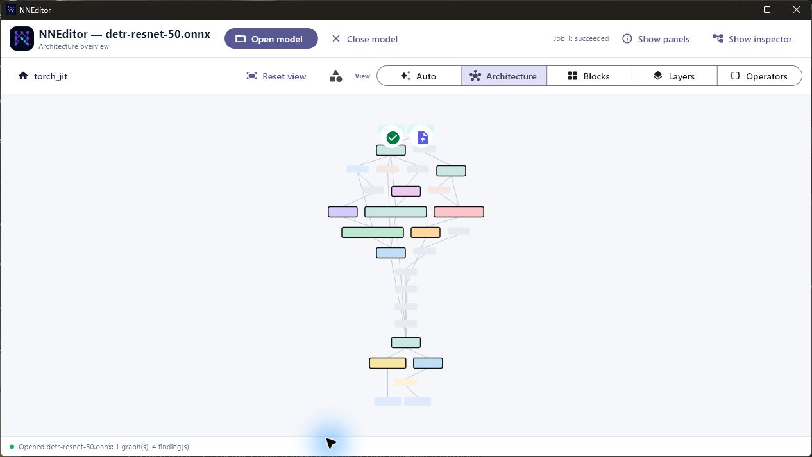
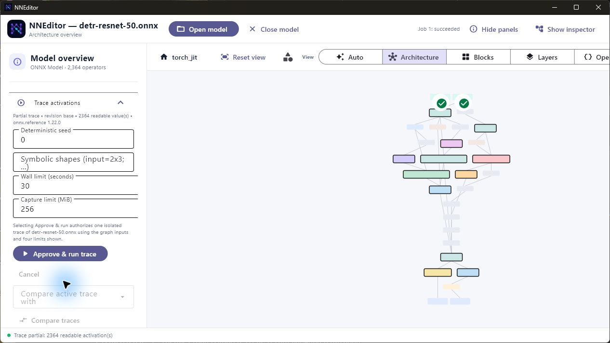
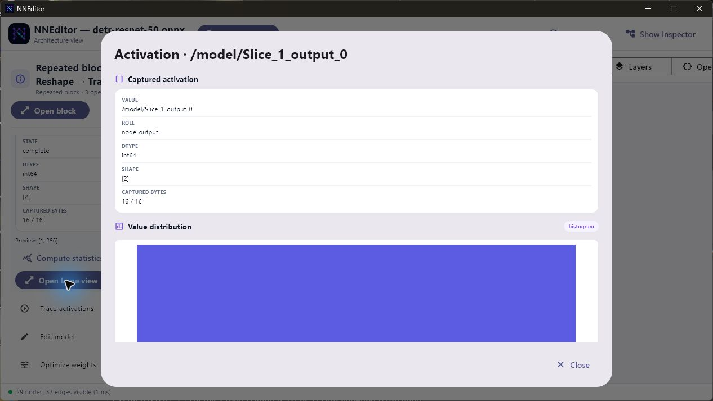

<p align="center">
  
</p>

<h1 align="center">NNEditor</h1>

<p align="center">
  Inspect, understand, edit, optimize, and trace neural-network artifacts
  without loading an entire model into memory or executing artifact-provided
  code.
</p>

NNEditor 1.0 is a capability-aware neural-network workspace for ONNX, PyTorch,
safetensors, GGUF, Hugging Face snapshots, and textual StableHLO artifacts. It
combines semantic graph
navigation, lazy tensor access, reversible editing, validated export, and
desktop activation tracing in one application.

## NNEditor in action

These screenshots come from a real desktop session with the 2,364-operator
`detr-resnet-50.onnx` model. The trace used the included fox image tensor and an
automatically generated all-valid pixel mask. It reached the approved 256 MiB
capture bound, so NNEditor reported an honest partial result while retaining
2,364 readable activations.

### Navigate a model by architecture



### Run a bounded activation trace



### Open activation data in a large view



## Highlights

- Navigate large graphs through architecture, block, layer, and operator views.
- Detect attention, feed-forward, convolutional, repeated, and structural
  regions with retained evidence and explanations.
- Read embedded and external tensors lazily through bounded byte ranges.
- Inspect tensor metadata, decoded previews, heatmaps, streaming statistics,
  and paged hexadecimal data.
- Apply reversible graph and tensor changes without modifying the source
  artifact.
- Save only when needed through a dirty-aware top-bar action, or close the
  current model without quitting the application.
- Generate safe `.npy` test inputs from images, masks, CSV data, synthetic
  time series, text token ids, or generic tensor patterns. Model inputs are
  detected and preconfigured automatically, and the complete generated set can
  be assigned in one action.
- Tokenize prompt text into language-model input ids through a selectable
  codebook: byte level, Unicode code points, or hashed words with no external
  files, plus GPT-2/RoBERTa byte-level BPE loaded from a HuggingFace
  `vocab.json` and `merges.txt` or a single `tokenizer.json`. Every codebook
  states how faithful its ids are to the model's own tokenizer.
- Preview quantization and pruning before committing them.
- Export validated ONNX revisions or clearly labelled weights-only artifacts.
- Trace ONNX activations in an isolated desktop worker and inspect values by
  clicking nodes, blocks, connections, inputs, or outputs.
- Explain every unavailable action through an explicit artifact capability
  contract.

## Supported artifacts

NNEditor identifies artifacts by their contents, not only by their extension.
The table describes the built-in readers and the strongest release-level
workflow available for each artifact.

| Artifact | Inspection | Editing | Export | Activation tracing |
|:--|:--|:--|:--|:--|
| ONNX model, including external data | Graphs, weights, metadata | Validated graph and tensor subset | ONNX with validation and provenance | Available on desktop |
| PyTorch exported program | Graph, parameters, buffers, constraints | Parameter and buffer bytes | Weights-only safetensors | Unavailable |
| PyTorch state dictionary | Weights and tensor metadata | Tensor-level changes | Weights-only artifact | Unavailable |
| PyTorch FX graph module | Partial topology and metadata | Unavailable | Unavailable | Unavailable |
| Safetensors | Weights and header metadata | Tensor-level changes | Safetensors | Unavailable |
| Flax or Orbax checkpoint | Weights and tensor metadata | Tensor-level changes | Weights-only artifact | Unavailable |
| Textual StableHLO | Functions, regions, operations, attributes | Inspection only | Unavailable | Unavailable |
| Qualcomm DLC container | Decoded graph, typed weights, quantization encodings, container index | Unavailable | Unavailable | Unavailable |
| Core ML package (.mlpackage) | Manifest, model header, feature names, typed weight blobs | Unavailable | Unavailable | Unavailable |
| GGUF (v1, v2, v3, including big-endian) | Synthetic LLM graph, lazy weights, architecture metadata | Tensor-level changes | Unavailable | Supported decoder configurations on desktop |
| Hugging Face snapshot directory | Synthetic LLM graph, config, tokenizer, lazy safetensors shards | Tensor-level changes | Weights-only safetensors | Supported decoder configurations on desktop |

Support is intentionally capability-specific. For example, opening a checkpoint
does not imply that NNEditor can reconstruct a model graph, and reading
StableHLO does not imply that NNEditor can write the dialect back. Unavailable
actions explain the format-specific reason directly in the interface.

Ternary Bonsai 2 files using the `qwen35` hybrid decoder, Prism `PQ2_0` or
`PTQ1_0` packed weights, and version 1 Hadamard transforms support desktop
tracing. The decoder implements gated full attention, partial text MRoPE,
causal convolution, and GatedDeltaNet recurrence. Weights stream in bounded
chunks, including the vocabulary projection; recurrent states reset for each
prompt. Select **Prepare prompt input**, generate or assign token IDs, then
select **Approve & run trace**. Word-hash inputs exercise the network; use
IDs from the model's tokenizer for a faithful text prompt.

## Installation

NNEditor requires Python 3.12, 3.13, or 3.14.

```bash
python -m pip install nneditor==1.9.0
```

Start the desktop application with either command:

```bash
nneditor
```

```bash
python -m nneditor
```

Open a model directly from the command line:

```bash
nneditor path/to/model.onnx
```

On Windows, select **File types** in the top bar to register NNEditor for
`.onnx`, `.pb`, `.pt2`, `.pt`, `.pth`, `.ckpt`, `.bin`, `.safetensors`,
`.mlir`, `.stablehlo`, `.dlc`, and `.gguf` files. NNEditor then opens Windows Default apps,
where you choose which extensions should launch it. Registration is per-user
and never replaces a protected Windows default without that explicit choice.

## First run

1. Select **Open model** and choose a supported artifact. NNEditor detects its
   format from the file contents. Directory bundles such as a Core ML
   `.mlpackage` or a Hugging Face snapshot open through **Open folder** on the
   desktop shell, or directly from the command line.
2. Start in the architecture view, then open a block or change the detail level
   to move through blocks, layers, and operators.
3. Select a node to inspect its ports, attributes, weights, and capability
   information.
4. Use search, breadcrumbs, the hierarchy explorer, keyboard navigation, and
   the minimap to move around large models.
5. Prepare edits or transformations in the left panel. NNEditor validates a
   preview before enabling **Commit**.
6. After a commit, **Save changes…** appears in the top bar. Select it to
   export the current revision to a new destination; it disappears after a
   successful save and returns after another change.
7. Select **Close model** to release the current artifact and return to the
   start screen without quitting NNEditor.

The opened source remains unchanged throughout this workflow. A recovered
sidecar revision is treated as unsaved and offers **Save changes…** immediately.

Large imports, statistics, exports, and traces run as cancellable background
jobs. The interface reports partial or unavailable data instead of presenting
it as complete.

## Activation tracing

Desktop tracing is available for ONNX models, GGUF files, and Hugging Face
snapshots.

1. Open **Generate test input**. NNEditor detects every model input and creates
   a preset from its name, dtype, and shape. Symbolic or unknown extents default
   to 1 and this assumption is shown in the input plan. **Automatic from input**
   is the default input source and generates deterministic values directly from
   that preset. Select an image, text, CSV, time-series, mask, or generic tensor
   source when you want to provide the values instead. When every input has a
   supported dtype and declared shape,
   use **Generate & assign all detected inputs** to create and validate the
   complete input set in one directory. You can also click the
   tensor-picker button inside an input node and choose an existing safe NumPy
   `.npy` tensor.
   Image dimensions are shown and applied as height then width, matching tensor
   shape conventions. Fixed Qwen3-VL `pixel_values` inputs automatically use
   the model-compatible flattened-patch profile.
   Required `*_mask` inputs left unchanged use an automatically generated
   all-valid mask; other inputs use deterministic random data.
   GGUF files and Hugging Face snapshots open the **Text tokens** source with a
   catalog of sample prompts. Sequence length left blank keeps the prompt's
   natural token length. A Hugging Face `tokenizer.json` is used when it is a
   complete byte-level BPE; otherwise words are hashed into the model's
   vocabulary so shapes and ranges are valid.
2. Open **Trace activations**, review the execution backend, execution device,
   input specification, and wall-clock, memory, capture, and chunk limits.
   For ONNX, **Automatic** tries installed GPU and NPU execution providers
   before CPU; an explicit GPU or NPU choice is strict and never silently runs
   on CPU. Automatic backend mode falls back from ONNX Runtime to NNEditor's
   axis-aware ONNX reference evaluator when no compatible runtime provider is
   available. The normalized reference option rewrites nonzero `Scan` axes
   with semantics-preserving transposes inside the private worker model.
   GGUF and Hugging Face traces run a numpy decoder-only forward pass on CPU.
   ONNX Runtime is not a backend for those formats.
3. Select **Approve & run trace**. This click creates an approval bound to the
   current model, inputs, and limits for that run only.
4. A successful trace opens the **Traced model** pane. It keeps the model graph's
   block structure and connections, adding small clickable ellipse ports:
   inputs on top of each block and outputs below. Hover over a port for its
   tensor name, shape, and capture status. Click a block to open its contents;
   **Parent block** returns through the same hierarchy as **Model graph**.
5. Click a port to open its tensor overlay. **View** shows a bounded table of
   values with row, column, and leading-axis slice controls. **Statistics** and
   **Visualization** load on demand and reuse cached results. Visualizations
   include histograms, line views, heatmaps, feature maps, and attention views
   where applicable. Export captured values as `.npy` and raster views as PNG.

Use the trace picker to revisit a captured run. Drag the graph to pan, scroll
to zoom, or search for a block or tensor and press Enter to jump to a match.
**Fit graph** shows the whole structure; **Readable view** restores a closer
view. Wide block signatures collect extra tensors into a `+` port that opens
a tensor chooser. Preview and unavailable captures are marked explicitly.
After a model edit, older traces remain inspectable in **Captured tensors**;
run another trace to show ports on the changed graph. The **Model graph**
inspector and its existing activation views also remain available.

The top-right device indicator shows the provider that actually completed the
latest trace. NNEditor recognizes ONNX Runtime's CUDA, TensorRT, DirectML,
OpenVINO GPU, MIGraphX, and ROCm GPU providers, plus OpenVINO NPU, Qualcomm QNN
HTP, and AMD Vitis AI NPU providers.

The base NNEditor installation ships no ONNX Runtime: every accelerator family
publishes its own distribution and all of them own the same `onnxruntime`
import name, so a fixed dependency on one would block the others. Install
exactly one runtime extra for the hardware you want to trace on:

| Install | Runtime |
|:--|:--|
| `pip install nneditor[runtime]` | CPU |
| `pip install nneditor[runtime-gpu]` | NVIDIA CUDA / TensorRT |
| `pip install nneditor[runtime-directml]` | Any Windows GPU via DirectML |
| `pip install nneditor[runtime-qnn]` | Qualcomm NPU (QNN HTP) |
| `pip install nneditor[runtime-openvino]` | Intel GPU and NPU via OpenVINO |

Without a runtime, automatic backend selection uses NNEditor's axis-aware ONNX
reference evaluator on CPU and says so; an explicit ONNX Runtime, GPU, or NPU
request fails with the extra to install. Accelerators additionally need their
vendor drivers in the same environment; follow the provider vendor's
compatibility and installation instructions.

Ready-made image and time-series tensors are available in
[examples/trace-inputs](examples/trace-inputs).

Input tensors are checked against the model's declared dtype and shape.
Approval is created only when **Approve & run trace** is selected, so a changed
input or limit cannot reuse stale consent. The UI captures graph inputs and
operator outputs by default so inspection does not depend on the selection that
was active when the trace began.

Tracing uses an isolated, resource-limited process. ONNX traces use ONNX
Runtime or NNEditor's axis-aware reference evaluator. GGUF and Hugging Face
traces use a numpy decoder-only worker that streams one layer at a time
(Llama-style RMSNorm, RoPE, grouped-query attention, and SwiGLU, plus
GPT-2-style fused projections where tensor names allow). Packed ggml types
without a decoder, other SSM architectures, scaled RoPE, sliding-window
attention, pickle shards, and in-memory edits are refused before execution. Unsupported models
remain available for inspection. Captures stream to disk as layers complete;
the trace panel guides prompt preparation and shows the CPU backend.

GGUF Qwen3.5 dense text traces also support Prism's g128 ternary packings,
explicit Hadamard signs, inverse embedding transforms, and grouped recurrent
output projections. Matrix products use decoded float32 weights and activations;
results can differ from optimized runtimes that additionally quantize activations.
Multimodal inputs, MoE decoders, and Prism version 2 tied output transforms are
not implemented.
The approved memory ceiling limits host RAM; device memory remains
under the accelerator provider and driver. A failed or cancelled run publishes
no trace.
Desktop subprocess isolation is not a multi-tenant security boundary, so
tracing is disabled in the browser application until a dedicated worker
service is available.

## Tracing extensions

Tracing implementations can be added without editing NNEditor's core. An
extension is a folder containing `nneditor-tracer.json`, a Python entry point,
and optional helper modules. The Trace panel offers built-in and installed
tracers, explains compatibility failures, and has **Install a tracer folder**
and **Reload tracer extensions** buttons. Installing an extension does not
import its Python code.

Create and install a working starter:

```bash
python -m nneditor --create-tracer ./my-tracer
# Edit my-tracer/nneditor-tracer.json and my-tracer/tracer.py.
python -m nneditor --install-tracer ./my-tracer
python -m nneditor --list-tracers
```

Select the installed tracer in **Trace**, prepare the model inputs, and choose
**Approve & run trace**. The starter delegates to the existing NumPy LLM
decoder. To support another architecture or runtime, replace its forward pass
and declare the corresponding compatibility filters. NNEditor supplies the
worker, limits, capture storage, and activation UI.

A manifest identifies its API, implementation, and supported artifacts:

```json
{
  "api_version": 1,
  "id": "mycompany.my-decoder",
  "name": "My decoder",
  "version": "0.1.0",
  "entry_point": "tracer.py:trace",
  "artifact_kinds": ["gguf_model", "huggingface_model"],
  "architectures": ["my_architecture"],
  "devices": ["cpu"]
}
```

`architectures`, `element_types`, and `operators` are optional allowlists.
Architectures match GGUF's architecture name or Hugging Face's `model_type`.
`devices` defaults to CPU; a runtime may declare GPU or NPU support. Installed
tracers can also target other imported artifact kinds with declared graph
inputs, including ONNX. Custom tracers currently execute source artifacts;
the built-in ONNX tracer retains support for edited revisions.

The entry point receives the public version 1 SDK:

```python
from nneditor.tracing.sdk import TraceContext, TraceOutcome

def trace(context: TraceContext) -> TraceOutcome:
    context.capture_inputs()
    # Run your forward pass using context.inputs and context.metadata.
    # Read packed weight slices through context.tensors.read(...), or decode
    # individual supported weights with context.load_weight(name_or_id).
    # Publish each activation immediately:
    # context.capture("block-000-attn", hidden_array)
    # context.capture("lm-head", logits_array)
    return TraceOutcome(provider="my-runtime", notes=("Runtime build 1.0",))
```

Capture names must match a unique value name in
`context.document.main_graph.values`; value IDs work too. Emit each value once
per forward pass. NNEditor applies capture selection and byte budgets; missing
requested values are visibly marked as dropped. A plugin may return
`TraceOutcome` with notes and diagnostics, or return `None`. It owns the model's
execution semantics and should validate configurations before reading weights.
Install runtime dependencies in the same Python environment as NNEditor.

For development, set `NNEDITOR_TRACE_PLUGIN_PATH` to the plugin folder or a
directory containing plugin folders. Multiple directories use the platform's
path separator. Edit the source and reload tracers directly. Installation
copies a folder into the per-user directory printed by `--list-tracers` and
refuses to overwrite an existing installation.

Approvals and capture identities bind the selected plugin version, code
fingerprint, and NNEditor version. NNEditor snapshots that code before execution; changes require a
fresh selection and approval. Plugin code runs in the resource-limited worker,
with the same timeout, cancellation, and capture handling as built-in tracers.
These limits are not an operating-system security sandbox: install trusted
plugin code. Artifact files themselves are never treated as plugins.

## Editing and optimization

### Validated ONNX editing

The 1.0 release supports a deliberately bounded entry-graph edit surface:

- rename nodes;
- edit supported scalar and list attributes;
- replace compatible operators;
- insert or remove validated unary operators;
- reconnect compatible inputs; and
- replace same-length tensor byte ranges.

Every change is prepared as a transaction, checked against the graph and ONNX
schema, and committed as a reversible revision. Undo, redo, recovery, diff
previews, and export provenance use the same revision chain.

### Quantization and pruning

NNEditor can preview and commit:

- 8-bit signed or unsigned, symmetric or asymmetric weight conversion;
- per-tensor and per-channel quantization;
- portable ONNX QuantizeLinear/DequantizeLinear insertion;
- threshold, mask, and exact `N:M` logical pruning; and
- a shape-proven terminal `MatMul` channel-pruning pattern.

The UI distinguishes a mathematical conversion from storage reduction or
runtime acceleration. Logical sparsity alone is never advertised as a smaller
or faster model.

## Safety and data integrity

NNEditor is safe-artifact-first:

- Import parses artifact bytes without importing or executing Python stored in
  the artifact.
- Pickle-based PyTorch containers are inspected through a restricted,
  non-executing reader.
- Source artifacts are immutable and identified by cryptographic content
  hashes.
- External tensor files are verified before their bytes are used.
- Tensor reads, caches, statistics, capture storage, and writes are bounded.
- Unsupported or ambiguous edits are rejected rather than approximated.
- Exports are staged, validated, and published as new artifacts.
- Inference requires explicit per-run approval and enforced resource limits.

## Large-model design

NNEditor avoids eager model materialization during normal inspection. Its ONNX
reader indexes protobuf wire ranges directly, tensor storage uses range reads
and bounded caches, and semantic graph levels keep the visible working set
manageable. The renderer is behind a toolkit-neutral contract and uses culling,
persistent shapes, and deterministic aggregation.

These choices make ordinary navigation responsive without pretending that an
unaggregated view containing tens of thousands of visible operators is cheap.

## Platform support

The desktop application targets:

- 64-bit Windows 10 and 11;
- macOS 12 or newer; and
- Debian 10–12 and Ubuntu 20.04, 22.04, and 24.04 LTS.

CI exercises Python 3.12, 3.13, and 3.14 on Linux and Python 3.14 on Windows.
The dynamic Flet browser application supports model inspection and editing, but
desktop-only tracing and browser multi-file export packaging remain unavailable.
Mobile packaging is outside the 1.0 release.

## Known boundaries

- Structural editing is limited to validated ONNX entry-graph cases.
- Custom or unknown operator schemas may be inspected but are not guessed
  during editing or tracing.
- PyTorch graph re-serialization and ONNX conversion are not included.
- Textual StableHLO is inspection-only.
- Weights-only exports do not contain executable topology.
- Browser tracing is disabled pending multi-user worker isolation.
- Text tokenization ships no vocabularies: byte, code-point, and hashed-word
  codebooks are self-contained, while BPE needs the model's own vocabulary
  files. The BPE pre-tokenizer approximates GPT-2's, so ids can differ from the
  reference tokenizer on unusual scripts or symbol runs; each codebook reports
  its own fidelity and the generated tensor records it.
- The original Python, module definitions, and training code cannot be
  reconstructed from serialized artifacts.

## Author

NNEditor was developed by **[Imed Bouazizi](https://bouazizi.dev)**.

## License

NNEditor is licensed under the [Apache License 2.0](LICENSE). Attribution and
copyright information is provided in [NOTICE](NOTICE).

## Development

The development environment is managed with
[uv](https://docs.astral.sh/uv/):

```bash
uv sync --locked --group dev
```

Run the desktop application:

```bash
uv run flet run src/main.py
```

Run the browser application:

```bash
uv run flet run --web src/main.py
```

On Windows, a moved or restored checkout can leave stale console-script paths
inside `.venv`. If `uv run flet` reports `Failed to canonicalize script path`,
repair the environment with `uv sync --locked --group dev --reinstall` before
launching it again. Python-backed quality gates use module invocation below so
they do not depend on those script shims.

Run the release quality gates:

```bash
uv run ruff format --check .
uv run ruff check .
uv run python -m mypy
uv run python -m pytest -m "not performance" \
  --cov=nneditor \
  --cov-report=term-missing \
  --cov-fail-under=90
uv run python -m pytest -m performance tests/performance
```

Build and validate the distributions:

```bash
uv build --clear
uvx twine check --strict dist/*
```
