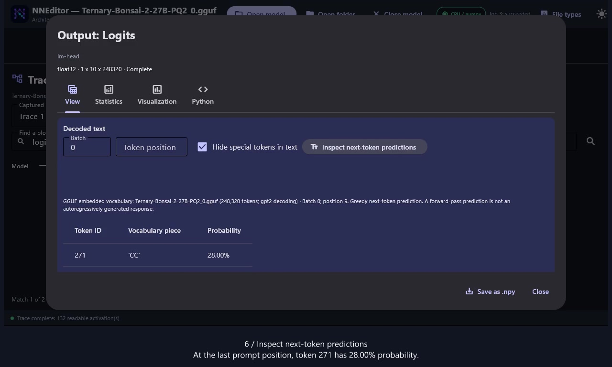
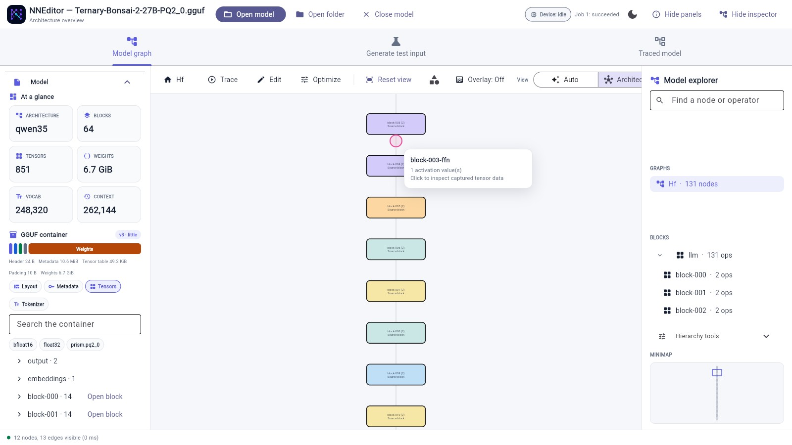
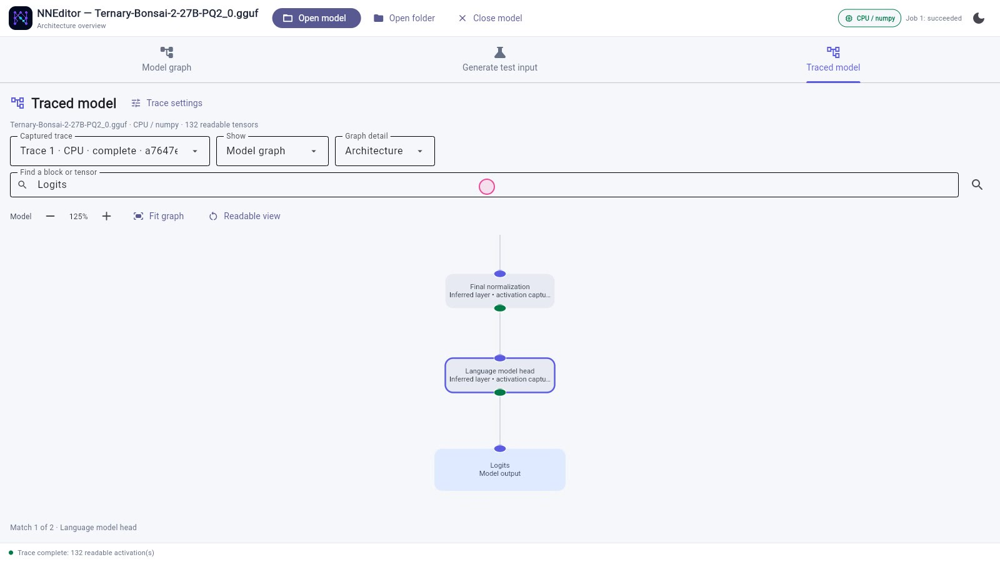
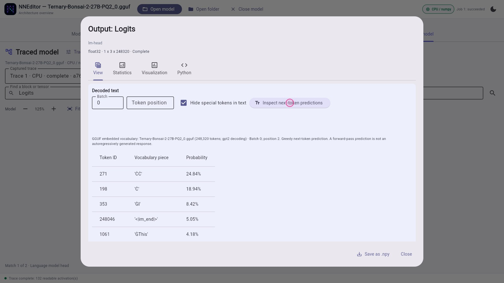
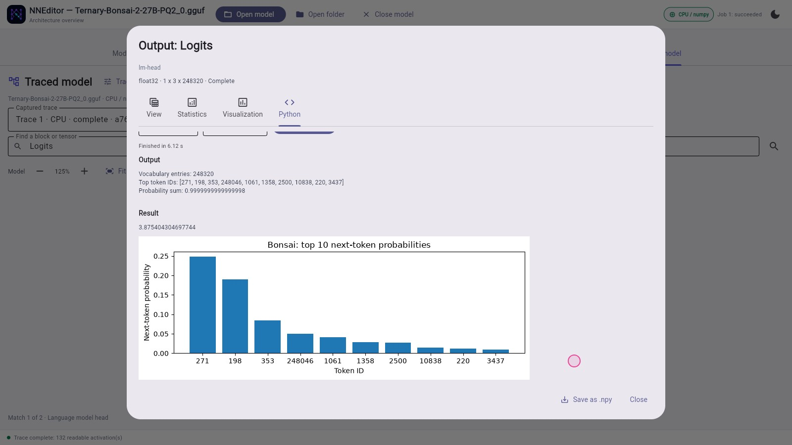

<p align="center">
  
</p>

<h1 align="center">NNEditor</h1>

<p align="center">
  Inspect, understand, edit, optimize, and trace neural-network artifacts
  without loading an entire model into memory or executing artifact-provided
  code.
</p>

NNEditor 2.1 is a capability-aware neural-network workspace for ONNX, PyTorch,
safetensors, GGUF, Hugging Face snapshots, and textual StableHLO artifacts. It
combines semantic graph
navigation, lazy tensor access, reversible editing, validated export, and
desktop activation tracing in one application.

## NNEditor in action

### Bonsai 27B: native Windows quick start

This video records the Windows desktop app using the checkpoint at
`../npu/models/bonsai2-27b/Ternary-Bonsai-2-27B-PQ2_0.gguf`.
Install the current checkout with `python -m pip install -e .`, then launch
`python -m nneditor`.

[](assets/videos/bonsai-native-walkthrough.mp4)

**[Watch or download the native walkthrough (MP4, 2:03)](assets/videos/bonsai-native-walkthrough.mp4)**
| [Captions](assets/videos/bonsai-native-walkthrough.srt)
| [Recorded results](examples/bonsai/native-walkthrough.json)

1. Choose **Open model** and select the Bonsai 27B GGUF above.
2. Open **Generate test input**, select **Text tokens** and the **Pangram**
   sample, and keep **GGUF embedded vocabulary (open model)** as the tokenizer.
3. Leave the sequence length blank, use **NT** layout and **int64**, and choose
   **npz**. Click **Generate, save & assign** to save the named `tokens` array.
4. Return to **Model graph** and open **Trace**. Review the CPU tracer, capture
   scope, time limit, and RAM limit, then choose **Approve & run trace**.
5. In **Traced model**, search for `logits` and click the output port below
   **Language model head**. Use **Inspect next-token predictions**,
   **Statistics**, and **Visualization** to examine the captured output.

The [saved input](examples/bonsai/bonsai27b-pangram.npz) contains the prompt
`The quick brown fox jumps over the lazy dog.` as an `int64` array of shape
`(1, 10)`. Generate fresh token IDs when using a different checkpoint.

This CPU NumPy run captured all **132 activations in full**. Its float32 logits
have shape `(1, 10, 248320)`. The video omits idle time and native file dialogs,
and shows the inference wait at **16x speed**, with instructions below the app.
The predictions describe a single forward pass at the last prompt position.

### Ternary Bonsai 2 27B: from GGUF to captured logits

The embedded-tokenizer and NPZ workflow shown here is available in the current
source checkout; install it with `python -m pip install -e .`.

This example opens the real `Ternary-Bonsai-2-27B-PQ2_0.gguf` checkpoint. Its GGUF
metadata describes a Qwen3.5 hybrid decoder with **64 blocks**, **248,320
vocabulary entries**, and about **6.7 GiB of weights**. NNEditor reads the
container, tokenizer, and tensor catalog lazily, then exposes the attention,
recurrent, and feed-forward structure for inspection.

[](assets/videos/bonsai-walkthrough.mp4)

**[Watch or download the Bonsai walkthrough (MP4)](assets/videos/bonsai-walkthrough.mp4)**
· [Captions](assets/videos/bonsai-walkthrough.srt)
· [Recorded results](examples/bonsai/provenance.json)

The recording shows opening the GGUF, generating and assigning its prompt input,
approving a trace, opening a captured output port, decoding token candidates,
checking statistics and visualizations, and running a Python analysis. Native
file dialogs are omitted, and the CPU inference wait is shown at **8× speed**.
The model execution, captures, decoded vocabulary pieces, and Python plots are
computed from this checkpoint in the recorded session.

**Prepare the model's own token IDs.** Open **Generate test input**, enter
`Hello world!`, and leave **GGUF embedded vocabulary (open model)** selected.
NNEditor reads `tokenizer.ggml.tokens`, `tokenizer.ggml.merges`, and the declared
`qwen35` pre-tokenizer rules from this file. For this checkpoint, the prompt
encodes to `[9419, 1814, 0]`. Its `add_bos_token` flag is false, so no BOS token is
inserted. **Output format → npz** saves a named `tokens` array; **Generate, save &
assign** validates it against the model input and assigns it to the next trace.

[The recorded NPZ input](examples/bonsai/hello-world.npz) can be inspected with:

```python
import numpy as np

with np.load("examples/bonsai/hello-world.npz", allow_pickle=False) as inputs:
    print(inputs["tokens"])  # [[9419, 1814, 0]], int64, shape (1, 3)
```

These IDs belong to this GGUF vocabulary. When opening a different checkpoint,
generate its input from that checkpoint's embedded tokenizer.

**Trace and inspect the block ports.** In **Trace**, review the input, selected
tracer, capture scope, and limits, then choose **Approve & run trace**. The
**Traced model** pane preserves the model's block structure and connections.
This recorded run captured all **132 activations in full**.
Click a small input or output ellipse to inspect its captured tensor, or use
**Find a block or tensor** to jump to **Logits**.



**Decode and analyze the output.** The final language-model head produces
float32 logits with shape `(1, 3, 248320)` for this prompt. In **View**, choose
**Inspect next-token predictions** to see the top candidates and probabilities
for a captured position. The overlay identifies the source GGUF and vocabulary
size. Its `gpt2` algorithm label describes byte decoding; the token strings and
IDs come from Bonsai's embedded vocabulary. The top candidate in this run is
`ĊĊ`, representing two newline characters, with about **24.84%** probability.



**Statistics** reports the captured tensor's counts and numerical distribution;
**Visualization** provides plots such as a histogram. These controls operate on
the captured forward pass. The next-token candidates are predictions at one
position, rather than a generated conversation or an autoregressive completion.

**Use Python for a custom analysis.** The **Python** tab supplies the captured
`tensor`, `metadata`, NumPy, SciPy, scikit-learn, `math`, and Matplotlib. The
[script used in the recording](examples/bonsai/analyze_logits.txt) selects the
last prompt position, computes a softmax, prints the top IDs, plots their
probabilities, and returns the entropy in nats (**3.8754** for this captured
position):

```python
logits = np.asarray(tensor)[0, -1].astype(np.float64)
probs = scipy.special.softmax(logits)
top = np.argsort(probs)[-10:][::-1]
print("Top token IDs:", top.tolist())
plt.bar(top.astype(str), probs[top])
plt.xlabel("Token ID")
plt.ylabel("Next-token probability")
plt.tight_layout()
float(scipy.stats.entropy(probs))
```



Use **Run script** or Ctrl+Enter to execute a fresh process. Printed output, the
last expression's result, and Matplotlib figures appear below the editor.
**Stop**, timeout, and RAM controls bound a run. Processing uses a private copy,
so in-place array operations preserve the original captured tensor.

This recording uses the **CPU NumPy GGUF tracer**. GPU support depends on the
selected tracer: installing CuPy or CUDA-enabled PyTorch does not change this
tracer's execution device. ONNX accelerator backends and plugins declaring GPU
support provide their own device execution.

### ONNX example: DETR ResNet-50

These screenshots come from a real desktop session with the 2,364-operator
`detr-resnet-50.onnx` model. The trace used the included fox image tensor and an
automatically generated all-valid pixel mask. It reached the approved 256 MiB
capture bound, so NNEditor reported an honest partial result while retaining
2,364 readable activations.

### Navigate a model by architecture


### Run a bounded activation trace


### Open activation data in a large view


## Highlights

- Navigate large graphs through architecture, block, layer, and operator views.
- Detect attention, feed-forward, convolutional, repeated, and structural
  regions with retained evidence and explanations.
- Read embedded and external tensors lazily through bounded byte ranges.
- Inspect tensor metadata, decoded previews, heatmaps, streaming statistics,
  and paged hexadecimal data.
- Apply reversible graph and tensor changes without modifying the source
  artifact.
- Save only when needed through a dirty-aware top-bar action, or close the
  current model without quitting the application.
- Generate safe `.npy` or named `.npz` test inputs from images, masks, CSV data, synthetic
  time series, text token ids, or generic tensor patterns. Model inputs are
  detected and preconfigured automatically, and the complete generated set can
  be assigned in one action.
- Tokenize prompt text into language-model input ids through a selectable
  codebook: byte level, Unicode code points, or hashed words with no external
  files, plus GPT-2/RoBERTa byte-level BPE loaded from a HuggingFace
  `vocab.json` and `merges.txt` or a single `tokenizer.json`, plus model-bound
  encoding from embedded GGUF vocabularies and merge tables. Every codebook
  states how faithful its ids are to the model's own tokenizer.
- Preview quantization and pruning before committing them.
- Export validated ONNX revisions or clearly labelled weights-only artifacts.
- Trace ONNX activations in an isolated desktop worker and inspect values by
  clicking nodes, blocks, connections, inputs, or outputs.
- Add tracing runtimes through folder-based plugins, with ready-to-edit LLM,
  Mamba/Mamba2 SSM, and Stable Diffusion UNet templates.
- Inspect captured tensors through clickable ports in the **Traced model**
  pane, decode token IDs and logits, or process values in the **Python** tab
  with NumPy, SciPy, scikit-learn, and Matplotlib preloaded.
- Explain every unavailable action through an explicit artifact capability
  contract.

## Supported artifacts

NNEditor identifies artifacts by their contents, not only by their extension.
The table describes the built-in readers and the strongest release-level
workflow available for each artifact.

| Artifact | Inspection | Editing | Export | Activation tracing |
|:--|:--|:--|:--|:--|
| ONNX model, including external data | Graphs, weights, metadata | Validated graph and tensor subset | ONNX with validation and provenance | Available on desktop |
| PyTorch exported program | Graph, parameters, buffers, constraints | Parameter and buffer bytes | Weights-only safetensors | Unavailable |
| PyTorch state dictionary | Weights and tensor metadata | Tensor-level changes | Weights-only artifact | Unavailable |
| PyTorch FX graph module | Partial topology and metadata | Unavailable | Unavailable | Unavailable |
| Safetensors | Weights and header metadata | Tensor-level changes | Safetensors | Unavailable |
| Flax or Orbax checkpoint | Weights and tensor metadata | Tensor-level changes | Weights-only artifact | Unavailable |
| Textual StableHLO | Functions, regions, operations, attributes | Inspection only | Unavailable | Unavailable |
| Qualcomm DLC container | Decoded graph, typed weights, quantization encodings, container index | Unavailable | Unavailable | Unavailable |
| Core ML package (.mlpackage) | Manifest, model header, feature names, typed weight blobs | Unavailable | Unavailable | Unavailable |
| GGUF (v1, v2, v3, including big-endian) | Synthetic LLM graph, lazy weights, architecture metadata | Tensor-level changes | Unavailable | Supported decoder configurations on desktop |
| Hugging Face snapshot directory | LLM/SSM or supported Diffusers UNet graph, config, tokenizer, lazy safetensors shards | Tensor-level changes | Weights-only safetensors | Supported decoders; Mamba/Mamba2 and Stable Diffusion UNet through plugins |

Support is intentionally capability-specific. For example, opening a checkpoint
does not imply that NNEditor can reconstruct a model graph, and reading
StableHLO does not imply that NNEditor can write the dialect back. Unavailable
actions explain the format-specific reason directly in the interface.

Ternary Bonsai 2 files using the `qwen35` hybrid decoder, Prism `PQ2_0` or
`PTQ1_0` packed weights, and Hadamard transforms (including a version 2 tied
output head) support desktop tracing. The decoder implements gated full attention, partial text MRoPE,
causal convolution, and GatedDeltaNet recurrence. Weights stream in bounded
chunks, including the vocabulary projection; recurrent states reset for each
prompt. Select **Prepare prompt input**, generate or assign token IDs, then
select **Approve & run trace**. Word-hash inputs exercise the network; use
IDs from the model's tokenizer for a faithful text prompt.

## Installation

NNEditor requires Python 3.12, 3.13, or 3.14.

```bash
python -m pip install nneditor==2.1.0
```

Start the desktop application with either command:

```bash
nneditor
```

```bash
python -m nneditor
```

Open a model directly from the command line:

```bash
nneditor path/to/model.onnx
```

On Windows, select **File types** in the top bar to register NNEditor for
`.onnx`, `.pb`, `.pt2`, `.pt`, `.pth`, `.ckpt`, `.bin`, `.safetensors`,
`.mlir`, `.stablehlo`, `.dlc`, and `.gguf` files. NNEditor then opens Windows Default apps,
where you choose which extensions should launch it. Registration is per-user
and never replaces a protected Windows default without that explicit choice.

## First run

1. Select **Open model** and choose a supported artifact. NNEditor detects its
   format from the file contents. Directory bundles such as a Core ML
   `.mlpackage` or a Hugging Face snapshot open through **Open folder** on the
   desktop shell, or directly from the command line.
2. Start in the architecture view, then open a block or change the detail level
   to move through blocks, layers, and operators.
3. Select a node to inspect its ports, attributes, weights, and capability
   information.
4. Use search, breadcrumbs, the hierarchy explorer, keyboard navigation, and
   the minimap to move around large models.
5. Prepare edits or transformations in the left panel. NNEditor validates a
   preview before enabling **Commit**.
6. After a commit, **Save changes…** appears in the top bar. Select it to
   export the current revision to a new destination; it disappears after a
   successful save and returns after another change.
7. Select **Close model** to release the current artifact and return to the
   start screen without quitting NNEditor.

The opened source remains unchanged throughout this workflow. A recovered
sidecar revision is treated as unsaved and offers **Save changes…** immediately.

Large imports, statistics, exports, and traces run as cancellable background
jobs. The interface reports partial or unavailable data instead of presenting
it as complete.

## Activation tracing

Desktop tracing is available for ONNX models, GGUF files, and Hugging Face
snapshots.

1. Open **Generate test input**. NNEditor detects every model input and creates
   a preset from its name, dtype, and shape. Symbolic or unknown extents default
   to 1 and this assumption is shown in the input plan. **Automatic from input**
   is the default input source and generates deterministic values directly from
   that preset. Select an image, text, CSV, time-series, mask, or generic tensor
   source when you want to provide the values instead. When every input has a
   supported dtype and declared shape,
   use **Generate & assign all detected inputs** to create and validate the
   complete input set in one directory. You can also click the
   tensor-picker button inside an input node and choose an existing safe NumPy
   `.npy` tensor or `.npz` archive. NPZ arrays match inputs by name; a
   single-array archive can also be assigned directly.
   Image dimensions are shown and applied as height then width, matching tensor
   shape conventions. Fixed Qwen3-VL `pixel_values` inputs automatically use
   the model-compatible flattened-patch profile.
   Required `*_mask` inputs left unchanged use an automatically generated
   all-valid mask; other inputs use deterministic random data.
   GGUF files and Hugging Face snapshots open the **Text tokens** source with a
   catalog of sample prompts. Sequence length left blank keeps the prompt's
   natural token length. GGUF models default to their embedded vocabulary,
   BPE merge table, declared pre-tokenizer, and special-token insertion flags;
   **npz** output stores an array named for the selected model input. Supported
   embedded byte-BPE rules include GPT-2, Qwen2, Qwen3.5/Bonsai, and Llama 3.
   Missing or unsupported GGUF tokenizer data produces an explicit error;
   synthetic codebooks remain an explicit smoke-test choice. A Hugging Face
   `tokenizer.json` is used when it is a complete byte-level BPE; otherwise its
   prompt preparation offers a clearly labelled hashed-word smoke test.
2. Open **Trace activations**, review the execution backend, execution device,
   input specification, and wall-clock, memory, capture, and chunk limits.
   For ONNX, **Automatic** tries installed GPU and NPU execution providers
   before CPU; an explicit GPU or NPU choice is strict and never silently runs
   on CPU. Automatic backend mode falls back from ONNX Runtime to NNEditor's
   axis-aware ONNX reference evaluator when no compatible runtime provider is
   available. The normalized reference option rewrites nonzero `Scan` axes
   with semantics-preserving transposes inside the private worker model.
   GGUF and Hugging Face traces run a numpy decoder-only forward pass on CPU.
   ONNX Runtime is not a backend for those formats.
3. Select **Approve & run trace**. This click creates an approval bound to the
   current model, inputs, and limits for that run only.
4. A successful trace opens the **Traced model** pane. It keeps the model graph's
   block structure and connections, adding small clickable ellipse ports:
   inputs on top of each block and outputs below. Hover over a port for its
   tensor name, shape, and capture status. Click a block to open its contents;
   **Parent block** returns through the same hierarchy as **Model graph**.
5. Click a port to open its tensor overlay. **View** shows a bounded table of
   values with row, column, and leading-axis slice controls. **Statistics** and
   **Visualization** load on demand and reuse cached results. Visualizations
   include histograms, line views, heatmaps, feature maps, and attention views
   where applicable. Export captured values as `.npy` and raster views as PNG.
   **Python** provides a script editor with the captured `tensor`, `metadata`,
   NumPy (`np`), `math`, SciPy (`scipy`), scikit-learn (`sklearn`, also `scikit`),
   and Matplotlib (`matplotlib`, `plt`) preloaded. Printed output, the last
   expression or a variable named `result`, and figures appear below the script.
   **Run script** or Ctrl+Enter starts a fresh process; **Stop** cancels it.
   Timeout and RAM controls bound a run. Scripts may import other installed
   libraries and save files using absolute paths. In-place processing leaves the
   captured tensor intact. A partial capture is exposed as a flat prefix, with
   the original shape in `metadata['shape']`.

The **View** tab also offers **Decode captured tokens** on token inputs and
**Inspect next-token predictions** on language-model logits. It uses the model's
GGUF vocabulary or Hugging Face `tokenizer.json`, supports batch and position
selection, and can retain special tokens. Logits show the greedy candidate and
top token probabilities for a complete captured vocabulary row. This is a
forward-pass prediction, rather than an autoregressively generated response.
Missing tokenizer data and incomplete logit rows are reported explicitly.
Hashed-word smoke-test inputs cannot recover their original prompt text.
For GGUF models, the overlay identifies the file and its embedded vocabulary
size. A `gpt2` decoding label means the byte-decoding algorithm declared by the
file; token IDs still use that GGUF's own `tokenizer.ggml.tokens` table, including
model-specific Qwen or Bonsai tokens. No external GPT-2 vocabulary is substituted.

Use the trace picker to revisit a captured run. Drag the graph to pan, scroll
to zoom, or search for a block or tensor and press Enter to jump to a match.
**Fit graph** shows the whole structure; **Readable view** restores a closer
view. Wide block signatures collect extra tensors into a `+` port that opens
a tensor chooser. Preview and unavailable captures are marked explicitly.
After a model edit, older traces remain inspectable in **Captured tensors**;
run another trace to show ports on the changed graph. The **Model graph**
inspector and its existing activation views also remain available.

The top-right device indicator shows the provider that actually completed the
latest trace. NNEditor recognizes ONNX Runtime's CUDA, TensorRT, DirectML,
OpenVINO GPU, MIGraphX, and ROCm GPU providers, plus OpenVINO NPU, Qualcomm QNN
HTP, and AMD Vitis AI NPU providers.

The base NNEditor installation ships no ONNX Runtime: every accelerator family
publishes its own distribution and all of them own the same `onnxruntime`
import name, so a fixed dependency on one would block the others. Install
exactly one runtime extra for the hardware you want to trace on:

| Install | Runtime |
|:--|:--|
| `pip install nneditor[runtime]` | CPU |
| `pip install nneditor[runtime-gpu]` | NVIDIA CUDA / TensorRT |
| `pip install nneditor[runtime-directml]` | Any Windows GPU via DirectML |
| `pip install nneditor[runtime-qnn]` | Qualcomm NPU (QNN HTP) |
| `pip install nneditor[runtime-openvino]` | Intel GPU and NPU via OpenVINO |

Without a runtime, automatic backend selection uses NNEditor's axis-aware ONNX
reference evaluator on CPU and says so; an explicit ONNX Runtime, GPU, or NPU
request fails with the extra to install. Accelerators additionally need their
vendor drivers in the same environment; follow the provider vendor's
compatibility and installation instructions.

Ready-made image and time-series tensors are available in
[examples/trace-inputs](examples/trace-inputs).

Input tensors are checked against the model's declared dtype and shape.
Approval is created only when **Approve & run trace** is selected, so a changed
input or limit cannot reuse stale consent. The UI captures graph inputs and
operator outputs by default so inspection does not depend on the selection that
was active when the trace began.

Tracing uses an isolated, resource-limited process. ONNX traces use ONNX
Runtime or NNEditor's axis-aware reference evaluator. GGUF and Hugging Face
traces use a numpy decoder-only worker that streams one layer at a time
(Llama-style RMSNorm, RoPE, grouped-query attention, and SwiGLU, plus
GPT-2-style fused projections where tensor names allow). Packed ggml types
without a decoder, other SSM architectures, scaled RoPE, sliding-window
attention, pickle shards, and in-memory edits are refused before execution. Unsupported models
remain available for inspection. Captures stream to disk as layers complete;
the trace panel guides prompt preparation and shows the CPU backend.

GGUF Qwen3.5 dense text traces also support Prism's g128 ternary packings,
explicit Hadamard signs, inverse embedding transforms, and grouped recurrent
output projections. Matrix products use decoded float32 weights and activations;
results can differ from optimized runtimes that additionally quantize activations.
Multimodal inputs and MoE decoders are not implemented.
The approved memory ceiling limits host RAM; device memory remains
under the accelerator provider and driver. A failed or cancelled run publishes
no trace.
Desktop subprocess isolation is not a multi-tenant security boundary, so
tracing is disabled in the browser application until a dedicated worker
service is available.

## Tracing plugins and extensions

A tracing plugin connects an execution runtime to NNEditor's imported model
graph. It receives the prepared inputs, runs a forward pass, and publishes
activations against graph value names or IDs. NNEditor supplies plugin discovery,
the approved worker process, resource limits, capture storage, and the tensor
inspection UI. The same plugin can handle a model family when the checkpoints
share the execution semantics it implements.

Plugins are ordinary folders containing a JSON manifest and a Python entry
point. No NNEditor source changes or Python package registration are needed to
add a runtime for an existing imported graph. A new artifact format or graph
structure also needs an appropriate model reader; a tracing plugin does not
register readers or create graph topology.

**NNEditor 2.1.0 uses tracing API version 1.** Keep `api_version: 1` in plugin
manifests. The application version, SDK API version, and each plugin's own
`version` are separate.

### Available tracers

| Tracer | Supported artifacts and execution | Runtime installation |
|:--|:--|:--|
| ONNX tracing, built in | ONNX Runtime or the reference evaluator; CPU and supported accelerators | Optional `nneditor[runtime]` or the appropriate accelerator extra |
| NumPy LLM decoder, built in | Supported GGUF and Hugging Face Llama, GPT-2, Qwen, and Bonsai decoder configurations on CPU | Included in `nneditor` |
| Mamba / Mamba2 SSM, bundled plugin | Local Hugging Face Mamba and Mamba2 safetensors checkpoints on CPU | `nneditor[tracer-ssm]` |
| Stable Diffusion UNet, bundled plugin | Diffusers `UNet2DConditionModel` and `UNet2DModel` components on CPU | `nneditor[tracer-diffusion]` |
| LLaVA, Qwen2-VL, and Gemma 3, bundled plugin | Local vision-language snapshots on CPU | `nneditor[tracer-modalities]` |
| BitNet, bundled plugin | Local BitNet snapshots and float32 BitNet GGUF files on CPU | `nneditor[tracer-modalities]` |
| GGUF vision and Whisper, bundled plugin | CLIP vision and Whisper GGUF files, including Q4 and Q8 weights, on CPU | `nneditor[tracer-modalities]` |
| SD3 and Flux, bundled plugin | Local SD3 and Flux transformer folders on CPU | `nneditor[tracer-modalities]` |
| CogVideoX and Wan, bundled plugin | Local video transformer folders on CPU | `nneditor[tracer-modalities]` |
| Whisper, bundled plugin | Local Whisper checkpoints on CPU | `nneditor[tracer-modalities]` |
| T5, bundled plugin | Local T5 checkpoints on CPU | `nneditor[tracer-modalities]` |
| RWKV, bundled plugin | Local RWKV checkpoints on CPU | `nneditor[tracer-modalities]` |

Whisper and vision-language tracing runs one CPU forward pass. **Automatic from
input** prepares coordinated synthetic inputs for diagnostics: Whisper mel
features at the configured frame count and a decoder start token, or image
tensors with matching image placeholders and grid metadata. These inputs do not
represent a recording, photograph, or user prompt. For real media, prepare named
`.npy` or `.npz` tensors with the checkpoint's processor and assign the complete
input set using the graph's input names. Generic image resizing does not replace
model-specific preprocessing.
GGUF Whisper requires decoder-start or BOS metadata for an automatic prefix.
If it is absent, assign the decoder tokens explicitly.

Captured stages distinguish Whisper convolutions, positional embeddings,
encoder and decoder blocks, and final logits. Vision-language graphs expose
feature selection and image/text merging. GGUF CLIP exposes each vision block,
the pooled output, and a separate sequence output. These tracers load the model
in float32 on CPU. They do not perform autoregressive transcription or caption
generation.

Install optional runtimes in the same Python environment as NNEditor:

```bash
python -m pip install "nneditor[tracer-ssm]==2.1.0"
python -m pip install "nneditor[tracer-diffusion]==2.1.0"
python -m pip install "nneditor[tracer-modalities]==2.1.0"
```

**Mamba / Mamba2 SSM:** open the checkpoint folder and prepare integer token IDs.
The plugin captures embeddings, complete SSM blocks, final normalization, and
logits, with fresh recurrent state for each run.

**Stable Diffusion UNet:** open the pipeline's **unet** folder containing
`config.json` and safetensors weights. Supported configurations include Stable
Diffusion 1.x, 2.x, and SDXL base/refiner conditioning. The graph exposes noisy
latents, timesteps, conditioning embeddings, down/up blocks, the bottleneck,
and actual skip tensors. SDXL adds pooled-text embeddings and time IDs. Supply
`.npy` inputs or use deterministic random tensors for a smoke test. A trace runs
one denoising forward pass and captures the latent/noise prediction; text
encoders, scheduler iterations, and VAE image decoding belong to the surrounding
pipeline.

Both bundled plugins refuse missing or incompatible weights. Their numerical
tests compare captured outputs with native model forwards. Unsupported UNet
configurations remain available for weight inspection. Example open-weight
checkpoints are [Mamba 130M](https://huggingface.co/state-spaces/mamba-130m-hf),
[Mamba2 130M](https://huggingface.co/AntonV/mamba2-130m-hf), and the UNet components
of [Stable Diffusion 1.5](https://huggingface.co/stable-diffusion-v1-5/stable-diffusion-v1-5)
and [Stable Diffusion XL](https://huggingface.co/stabilityai/stable-diffusion-xl-base-1.0).

### Install and use a plugin

1. Install the plugin's runtime dependencies in NNEditor's Python environment.
2. In **Trace**, choose **Install a tracer folder**, or run:

   ```bash
   nneditor --install-tracer ./my-tracer
   nneditor --list-tracers
   ```

3. If NNEditor is already open, choose **Reload tracer extensions**. Select the
   tracer in **Trace**. The panel explains incompatible architectures, operators,
   weight types, and missing dependencies before execution.
4. Prepare inputs, select the device and resource limits, and choose
   **Approve & run trace**.
5. Inspect the captured run in **Traced model**. Click the small ellipse input
   or output ports to open **View**, **Statistics**, **Visualization**, or
   **Python**. Compatible token and logits captures also offer decoded text.

Installation validates and copies the folder into the per-user tracer directory
printed by `--list-tracers`. It does not import the plugin's Python code and
refuses to overwrite an existing installation. Bundled plugins are discovered
automatically; only their optional runtimes need installation.

### Author a new plugin

**1. Generate a working template.** Choose the implementation closest to your
model family:

```bash
nneditor --create-tracer ./my-llm-tracer --tracer-template llm
nneditor --create-tracer ./my-ssm-tracer --tracer-template ssm
nneditor --create-tracer ./my-diffusion-tracer --tracer-template diffusion
```

The `llm` template is the default when `--tracer-template` is omitted. It delegates
to NNEditor's existing NumPy decoder. The `ssm` and `diffusion` templates copy the
working bundled implementations. Each command creates a new folder:

```text
my-llm-tracer/
  nneditor-tracer.json
  tracer.py
```

Add helper modules or small data files alongside the entry point as needed.
Relative sibling imports, such as `from .helpers import forward`, are supported.
Keep installed runtime packages and model weights outside the plugin folder;
plugin folders are limited to 32 MiB and 1,024 files and cannot contain symlinks.

**2. Set the plugin identity and compatibility.** Give every installed plugin a
unique lowercase `id`, a readable `name`, and its own `version`. Generated SSM
and diffusion copies use `example.*` IDs to avoid colliding with bundled plugins;
replace them before distributing your plugin. A working NumPy-decoder manifest
can be as small as:

```json
{
  "api_version": 1,
  "id": "mycompany.numpy-decoder",
  "name": "My NumPy decoder",
  "version": "0.1.0",
  "entry_point": "tracer.py:trace",
  "artifact_kinds": ["gguf_model", "huggingface_model"],
  "architectures": ["llama", "gpt2", "qwen2", "qwen3", "qwen35"],
  "devices": ["cpu"],
  "streaming_weights": true
}
```

| Manifest field | Meaning |
|:--|:--|
| `api_version` | Required SDK version; currently `1`. |
| `id`, `name`, `version` | Required plugin identity, display name, and implementation version. The `builtin.*` ID namespace is reserved. |
| `entry_point` | Required relative Python file and callable, such as `tracer.py:trace` or `runtime/tracer.py:trace`. |
| `artifact_kinds` | Required nonempty list of imported artifact kinds, such as `gguf_model`, `huggingface_model`, or `onnx_model`. |
| `architectures` | Optional allowlist matching the GGUF architecture, Hugging Face `model_type`, or Diffusers `_class_name`. |
| `element_types`, `operators` | Optional allowlists for weight element types and graph operator names the runtime supports. |
| `devices` | Concrete devices: `cpu`, `gpu`, or `npu`. Defaults to CPU. The plugin implements execution on its declared devices. |
| `python_modules` | Optional list of top-level import names to check before execution, such as `torch` and `diffusers`. Dependencies are installed separately. |
| `install_extra` | Optional missing-dependency hint for an existing NNEditor extra, used by the bundled plugins. It does not install packages or define a new extra. |
| `streaming_weights` | Defaults to `false`, with whole-model RAM defaults. Use `true` only if the implementation loads bounded weight portions at a time. |
| `description` | Optional explanation displayed in the trace panel. |

Compatibility filters describe what the implementation can execute. Adding an
architecture to the manifest does not implement its forward pass or guarantee
that a quantized weight format is supported.

**3. Implement `trace(context)`.** Import the public SDK from
`nneditor.tracing.sdk`. This complete entry point works with the manifest above:

```python
from nneditor.tracing.sdk import TraceContext, TraceOutcome


def trace(context: TraceContext) -> TraceOutcome:
    return context.trace_numpy_decoder()
```

For a new runtime, replace the delegation with your model's forward pass.
Validate the configuration and checkpoint weights, call
`context.capture_inputs()`, and publish intermediate and output arrays as soon
as they are ready. These are the public integration points:

| SDK member | Purpose |
|:--|:--|
| `context.document` | Imported graph and tensor references. Use `main_graph.values` to inspect capture IDs and names. |
| `context.inputs` | Prepared NumPy arrays keyed by model input names. |
| `context.metadata` | GGUF metadata or the Hugging Face/Diffusers configuration. |
| `context.tensors` | Lazy weight store; `read(...)` supports bounded byte ranges. |
| `context.load_weight(name_or_id)` | Decode one supported weight. Read slices instead when a whole decoded tensor would exceed your budget. |
| `context.device`, `context.limits` | Selected execution device and approved resource limits. |
| `context.capture_inputs()` | Publish declared input arrays. |
| `context.capture(value_name_or_id, array)` | Publish a real numeric NumPy activation against one existing graph value. |
| `context.trace_numpy_decoder()` | Reuse NNEditor's built-in streaming LLM implementation. |

Capture names must identify a unique value in `context.document.main_graph`;
use value IDs if names are ambiguous. Emit each value once per forward pass.
For example, a compatible decoder can publish
`context.capture("lm-head", logits_array)` when its graph contains that value.
NNEditor applies capture selection and byte budgets; missing requested values
are visibly marked as dropped. Return `TraceOutcome(provider="my-runtime",
notes=("Runtime build 1.0",))` to identify execution details, or return `None`.
Raise `TracePluginError` for an actionable configuration or runtime error.
Custom plugins execute source artifacts; the built-in ONNX tracer also supports
edited revisions.

**4. Develop without reinstalling.** Point discovery at your source folder:

```bash
# Linux/macOS; multiple paths are separated by a colon.
export NNEDITOR_TRACE_PLUGIN_PATH="$PWD/my-llm-tracer"
nneditor --list-tracers
nneditor path/to/model.gguf
```

```powershell
# PowerShell; multiple paths are separated by a semicolon.
$env:NNEDITOR_TRACE_PLUGIN_PATH = (Resolve-Path .\my-llm-tracer).Path
nneditor --list-tracers
nneditor path/to/model.gguf
```

A search path can name one plugin folder or a directory containing plugin
folders. Use **Reload tracer extensions** after edits. For a distributable
installation, share the folder containing the manifest and source, document its
runtime dependencies, and use `--install-tracer`. Increment the plugin's
`version` when shipping changes. To update an installed copy, first locate its
folder with `--list-tracers`, back it up or remove it, then install the new copy.

**5. Validate with a small real model.** Check input and output shapes, compare
captured outputs with the runtime's native forward pass, and confirm that every
intended graph port is captured. Exercise an incompatible configuration, a
missing dependency, cancellation, and the selected resource limits. The
[plugin tests](https://github.com/ibouazizi/nneditor/blob/main/tests/unit/test_trace_plugins.py)
and [Mamba/Stable Diffusion numerical tests](https://github.com/ibouazizi/nneditor/blob/main/tests/integration/test_family_tracers.py)
show working test patterns. Core contributors can run them with:

```bash
uv run python -m pytest tests/unit/test_trace_plugins.py tests/unit/test_family_graphs.py
uv run python -m pytest tests/integration/test_family_tracers.py
```

### Discovery and execution behavior

Discovery reads manifests and fingerprints plugin files without importing their
Python entry points. Duplicate plugin IDs disable the conflicting entries;
malformed manifests appear in `--list-tracers` diagnostics. A disabled trace
button should be resolved through the displayed compatibility or installation
message, then by reloading plugins and preparing the required inputs.

Approvals and capture identities bind the plugin version, code fingerprint, and
NNEditor version. NNEditor snapshots the approved code before execution; edits
require a fresh selection and approval. Plugin code runs in the resource-limited
worker with timeout, cancellation, and capture handling. These limits are not an
operating-system security sandbox: install trusted plugin code. Artifact files
are never treated as plugins.

## Editing and optimization

### Validated ONNX editing

The 1.0 release supports a deliberately bounded entry-graph edit surface:

- rename nodes;
- edit supported scalar and list attributes;
- replace compatible operators;
- insert or remove validated unary operators;
- reconnect compatible inputs; and
- replace same-length tensor byte ranges.

Every change is prepared as a transaction, checked against the graph and ONNX
schema, and committed as a reversible revision. Undo, redo, recovery, diff
previews, and export provenance use the same revision chain.

### Quantization and pruning

NNEditor can preview and commit:

- 8-bit signed or unsigned, symmetric or asymmetric weight conversion;
- per-tensor and per-channel quantization;
- portable ONNX QuantizeLinear/DequantizeLinear insertion;
- threshold, mask, and exact `N:M` logical pruning; and
- a shape-proven terminal `MatMul` channel-pruning pattern.

The UI distinguishes a mathematical conversion from storage reduction or
runtime acceleration. Logical sparsity alone is never advertised as a smaller
or faster model.

## Safety and data integrity

NNEditor is safe-artifact-first:

- Import parses artifact bytes without importing or executing Python stored in
  the artifact.
- Pickle-based PyTorch containers are inspected through a restricted,
  non-executing reader.
- Source artifacts are immutable and identified by cryptographic content
  hashes.
- External tensor files are verified before their bytes are used.
- Tensor reads, caches, statistics, capture storage, and writes are bounded.
- Unsupported or ambiguous edits are rejected rather than approximated.
- Exports are staged, validated, and published as new artifacts.
- Inference requires explicit per-run approval and enforced resource limits.

## Large-model design

NNEditor avoids eager model materialization during normal inspection. Its ONNX
reader indexes protobuf wire ranges directly, tensor storage uses range reads
and bounded caches, and semantic graph levels keep the visible working set
manageable. The renderer is behind a toolkit-neutral contract and uses culling,
persistent shapes, and deterministic aggregation.

These choices make ordinary navigation responsive without pretending that an
unaggregated view containing tens of thousands of visible operators is cheap.

## Platform support

The desktop application targets:

- 64-bit Windows 10 and 11;
- macOS 12 or newer; and
- Debian 10–12 and Ubuntu 20.04, 22.04, and 24.04 LTS.

CI exercises Python 3.12, 3.13, and 3.14 on Linux and Python 3.14 on Windows.
The dynamic Flet browser application supports model inspection and editing, but
desktop-only tracing and browser multi-file export packaging remain unavailable.
Mobile packaging is outside the 1.0 release.

## Known boundaries

- Structural editing is limited to validated ONNX entry-graph cases.
- Custom or unknown operator schemas may be inspected but are not guessed
  during editing or tracing.
- PyTorch graph re-serialization and ONNX conversion are not included.
- Textual StableHLO is inspection-only.
- Weights-only exports do not contain executable topology.
- Browser tracing is disabled pending multi-user worker isolation.
- Text tokenization ships no vocabularies: byte, code-point, and hashed-word
  codebooks are self-contained, while BPE needs the model's own vocabulary
  files. The BPE pre-tokenizer approximates GPT-2's, so ids can differ from the
  reference tokenizer on unusual scripts or symbol runs; each codebook reports
  its own fidelity and the generated tensor records it.
- The original Python, module definitions, and training code cannot be
  reconstructed from serialized artifacts.

## Author

NNEditor was developed by **[Imed Bouazizi](https://bouazizi.dev)**.

## License

NNEditor is licensed under the [Apache License 2.0](LICENSE). Attribution and
copyright information is provided in [NOTICE](NOTICE).

## Development

The development environment is managed with
[uv](https://docs.astral.sh/uv/):

```bash
uv sync --locked --group dev
```

Run the desktop application:

```bash
uv run flet run src/main.py
```

Run the browser application:

```bash
uv run flet run --web src/main.py
```

On Windows, a moved or restored checkout can leave stale console-script paths
inside `.venv`. If `uv run flet` reports `Failed to canonicalize script path`,
repair the environment with `uv sync --locked --group dev --reinstall` before
launching it again. Python-backed quality gates use module invocation below so
they do not depend on those script shims.

Run the release quality gates:

```bash
uv run ruff format --check .
uv run ruff check .
uv run python -m mypy
uv run python -m pytest -m "not performance" \
  --cov=nneditor \
  --cov-report=term-missing \
  --cov-fail-under=90
uv run python -m pytest -m performance tests/performance
```

Build and validate the distributions:

```bash
uv build --clear
uvx twine check --strict dist/*
```
